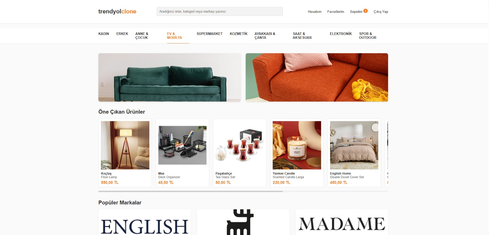
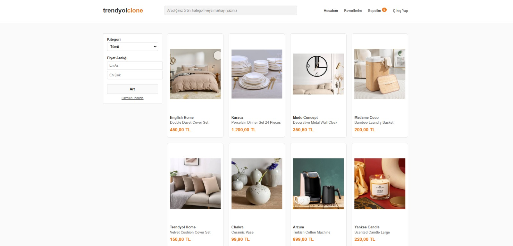
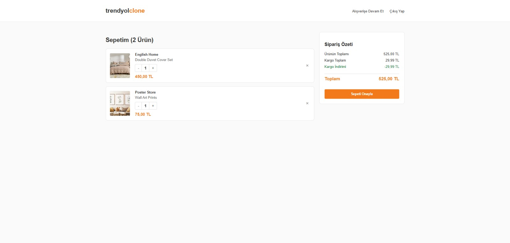

# Trendyol Clone

End-to-end e-commerce platform inspired by Trendyol, built with a scalable backend, interactive frontend, featuring authentication, product and shopping cart management with database integration.

## 🧠 Project Overview

This project replicates the core workflow of a modern e-commerce system.  
Users can log in, browse products, add items to their cart, and view order summaries.  
The system demonstrates the connection between frontend interfaces, backend logic, and a relational database.

## 🚀 Features

- User login & logout  
- Product listing  
- Shopping/cart operations  
- Order summary  
- Database connectivity  
- Structured configuration management

## 📸 Screenshots

| Home page | Product listing |
|---|---|
|  |  |

<p align="center"></p>

## 📁 Project Structure
```
├── Config.php      # Database connection settings
├── Index.php       # Home page: highlighted and recently added products
├── Login.php       # Login form and session start
├── Logout.php      # Ends the session
├── Products.php    # Product listing with search, category and price filters
├── Shopping.php    # Product detail page and add-to-basket
├── Summary.php     # Basket / order summary with quantity updates
├── style.css
├── database.sql    # Schema and seed data
└── docs/           # Project report (PDF and DOCX) and screenshots
```

## 🛠 Technologies Used

- **Backend:** PHP  
- **Frontend:** HTML, CSS  
- **Database:** SQL  

## ▶ How to Run

1. Start a local PHP + MySQL server (XAMPP, WAMP, etc.).
2. Create the database and tables by importing `database.sql`.
3. Update the credentials in `Config.php` if your MySQL user is not `root` with an empty password.
4. Open `Login.php` on localhost and sign in with a demo account: `admin` / `password123` or `user` / `12345`.

## 🔒 Security Notes

- Passwords are stored as `password_hash()` (bcrypt) hashes and checked with `password_verify()`.
- The login query uses a prepared statement; numeric inputs are cast before they reach SQL.
- `Config.php` holds local development credentials only; do not deploy it with real secrets.

## 📄 Project Report

Detailed documentation of the system, screenshots, database design, and application workflow can be found in the project report below:

👉 [Read the Report (PDF)](docs/Trendyol_Clone_Report.pdf) · [DOCX](docs/Trendyol_Clone_Report.docx)

## 💡 Purpose of the Project

This project was developed as a portfolio application to practice full-stack development, database integration, and user-based workflows in an e-commerce environment.


